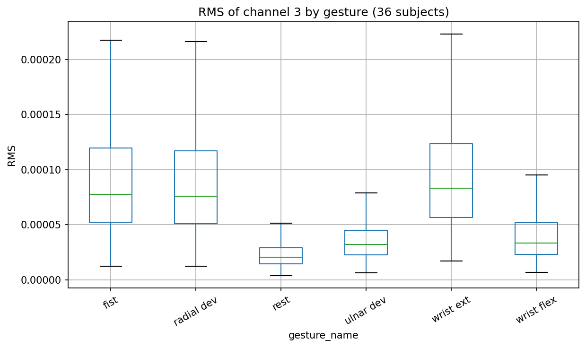

# EMG Gesture Signal Analysis

Analysis of surface EMG signals from 36 subjects performing 6 hand gestures,
using Python (pandas, SciPy, scikit-learn).

## Dataset
UCI "EMG data for gestures": 8 channels, 1000 Hz, 36 subjects, 6 gestures
(rest, fist, wrist flexion, wrist extension, radial deviation, ulnar deviation).
The data is not included in this repo; download it from the UCI repository
and place the subject folders in `data/`.

## Method
1. Bandpass filter (20-450 Hz, 4th-order Butterworth, zero-phase)
2. Sliding windows: 200 ms, 50% overlap, windows spanning two gestures discarded
3. Time-domain features per channel: RMS, MAV, waveform length (24 features/window)
4. Kruskal-Wallis test per channel with Bonferroni correction
5. Random forest classifier evaluated with subject-wise cross-validation

## Results
- 13,292 windows from 36 subjects, roughly balanced across the 6 gestures.
- RMS differs significantly between gestures on all 8 channels
  (Kruskal-Wallis, Bonferroni-corrected, p < 1e-300).
- Between-subject variation in mean RMS (channel 3) is comparable to
  between-gesture variation (variance ratio 0.78).
- Random forest accuracy: **81.8%** on unseen subjects (5-fold GroupKFold,
  folds 77.4-87.9%) versus 93.8% with a random split, showing how much a
  random split overstates performance.

## Limitations
- Windows overlap and come from only 36 people, so p-values are optimistic;
  a mixed-effects model would be a better test.
- Variance ratio is a rough measure on one channel and one feature.
- No hyperparameter tuning was done.

## How to run
pip install -r requirements.txt
Open `emg_analysis.ipynb` and run all cells.